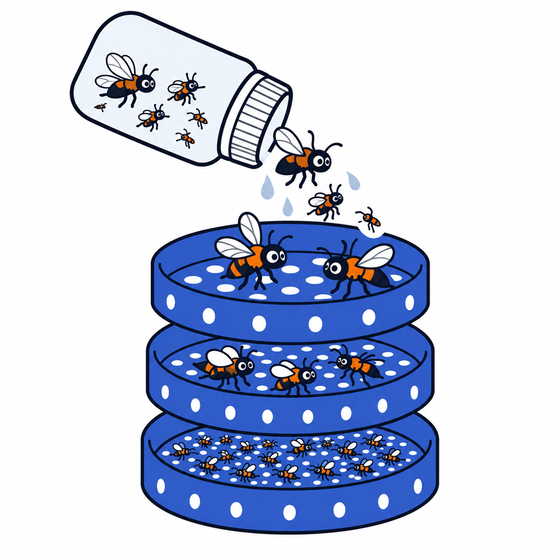

<p align="center">
  
</p>

<h1 align="center">testSieveSorter</h1>

<p align="center"><b>Break up a Malaise clump, then sort the insects by size: printed parts for BioKEA's BugSorter, designed in simulation.</b></p>

> **Status: design stage.** The parts are printable and a physics simulation ranks them, but nothing from this repo has been bench-tested yet. [docs/EVIDENCE.md](docs/EVIDENCE.md) lays out what's proven, what's only simulated, and the one-day bench plan that settles it.

## The problem

- **The input.** BioKEA images and DNA-barcodes insects from Malaise traps: thousands of mostly tiny flies in ethanol. The sample often arrives as a **compacted clump**, tangled insects mixed with leaves, twigs and dirt.
- **Why it's hard.** Sieves only sort specimens that are already loose. Pulling a clump apart by hand is slow, and snapped legs ruin specimens for imaging.
- **What exists.** [BugSorter](https://github.com/BioKEA/BugSorter) is BioKEA's upgrade of [EntoSieve](https://pmc.ncbi.nlm.nih.gov/articles/PMC12225705/), the published automated sieve tower. It shakes a stack of glued-mesh trays with one stepper-driven axis, run from an ESP32 web app.
- **What we change.** We keep its electronics, firmware and spray, and redesign the parts it shakes: a layer that breaks the clump up first, then sieve levels that rock.

## The machine


**3D model:** 13 printed parts, 11 h 44 min and 457 g of PLA on a P1S, plus steel pins, a few bolts and a tactile transducer.
- the [**interactive 3D model**](https://claude.ai/artifact/5EDjukCiJH2rjHP8DB8uS1) rocks the stack the way the drive moves it, with BugSorter's stroke and speed settings as sliders (rebuild it with `cad/product_view.py`);
- [`docs/assets/product.stl`](docs/assets/product.stl) opens in GitHub's 3D viewer;
- `cad/out/product_assembly.step` is the full assembly, built by `cad/product.py`;
- the build sheet, with parts, hardware, assembly and assumptions, is **[cad/PRODUCT.md](cad/PRODUCT.md)**.

| Stage | What it is | Why |
|---|---|---|
| **1. Breaker** (top level) | A printed grid of 11.3 mm openings with 40 blunt pins, 3.1 × 8 mm, designed by the optimizer (B-164f355a). 57 min and 19.6 g on a Bambu P1S. | The rocking throws the clump onto the pins and the spray weakens it. Freed specimens fall through; leaves stay on top. |
| **2. Sieve levels** | 5 mm and 2 mm printed screens, with low ribs running across the tilt, each in its own holder box | Coarse to fine, one size class per level, as in BugSorter and EntoSieve |
| **3. Catch pan** | A deeper box with a solid floor and an inward lip | Collects the smallest class, and grains that bounce at the ends stay in |
| **4. Seesaw motion** | Each box tips about its own centre, ±10°, and **neighbours tip opposite ways**. Whatever drops from a level lands on a tray tilted the other way. | Material slides end to end across each screen, as in a gold pan. The alternation keeps it from flying off. |
| **5. Drive** | Two push rods hang from BugSorter's existing stage: one drives the odd levels, one the even. The firmware's default 2 cm stroke gives ±10°. Keep the stroke under 2.3 cm: neighbours touch at 2.5 cm. | No new motor or firmware. The stroke setting in the web app sets the angle. |
| **6. Buzz** | A tactile transducer on the drive, 0.35 mm at 40 Hz, from a Raspberry Pi (`pi/buzz.py`) | The seesaw alone stays under the angle at which grains slide (about 22°). The buzz is what makes it sort in the sim. |
| **7. Spray** | BugSorter's fixed jets, unchanged | In the sim, wetting is what finishes breaking up an insect clump |

## What the evidence says

| | |
|---|---|
| **Proven, by others** | Stacked sieves sort real Malaise insects into length classes at 92–99% (EntoSieve). Forum Shah's printed 5 mm tray sorts pasta from rice on the bench. |
| **Checked in software** | Every part is a valid, watertight solid that fits the P1S bed, with no printability flags. The breaker is sliced. |
| **Simulated only, uncalibrated** | The breaker frees clumps, the seesaw with the buzz sorts, and the drive gives ±10° |
| **Not yet known** | Whether the parts fit a real BugSorter box: its dimensions come from a drawing. Then the break-up and damage on real clumps, and sorting counts. |

The sim now runs the insects wet, under ethanol ([sim/LIQUID.md](sim/LIQUID.md)), but it has no flow in the liquid. When EntoSieve is rebuilt in the sim, the holes cut by body length as in the paper, but only 28–81% of each class gets through, against 96–100% for real ([sim/ENTOSIEVE.md](sim/ENTOSIEVE.md)). Details, and the bench plan: [docs/EVIDENCE.md](docs/EVIDENCE.md).

## Results from the simulation

MuJoCo, uncalibrated. These numbers **rank** designs; they don't predict bench percentages. Replays of every run are in the **Sieve Render Lab** (`sim/render_site/build_site.py` builds it).

**1. The breaker frees a clump that the seesaw alone can't.** The clump is 35 Malaise-size insects (2–6 mm and over 6 mm) with a leaf, a twig and dirt, held by 155 bonds of medium strength:

| Top level | Freed | Half / 90% freed by | Largest piece left |
|---|---|---|---|
| No breaker, ±10° seesaw | **9%** | never | 32 of 35 |
| Breaker B-164f355a + buzz + spray, ±7° seesaw | **100%** | 3.5 s / 5.0 s | 1 |

With the real Malaise size mix (57% under 1.5 mm), the same breaker frees 25% dry and 90% with the spray on, in 4 s (one seed, `sim/CLUMPS.md`).

**2. The optimizer designed that breaker**, and beat the hand-designed one (`sim/opt/leaderboard_malaise.md`). Every candidate ran on weak, medium and strong clumps, and winners had to hold up on freshly packed ones:

| Breaker | Motion | Score | Freed (fresh clumps) |
|---|---|---|---|
| **B-164f355a**: 11.3 mm grid, round pins 3.1 × 8 mm | ±7°, 1.1 s + 0.35 mm 40 Hz buzz | **0.630** | **94%** |
| Hand-designed: 8 mm grid, 2.5 × 12 mm pins, + buzz | ±10°, 2 s + 0.3 mm | 0.452 | 84% |
| No breaker | ±10°, 2 s | 0.229 | 48% |

**3. Sorting on the seesaw: what the sim changed.** 125 grains of all 10 modelled kinds, ±10° alternating seesaw, 12 s:

| Where grains ended | Before: old inserts, 85 mm apart, seesaw only | After: ribs-across inserts, centre-pivot holders 55 mm apart, + 0.3 mm 40 Hz buzz |
|---|---|---|
| Pasta, chickpea on 5 mm | 15 / 15 | 15 / 15 |
| Quinoa, couscous, chia in the catch | 30 / 45 (12 stuck on the 5 mm ribs) | **44 / 45** |
| Black and wild rice on 2 mm | 16 / 22 | 20 / 22 |
| Plain and white rice on 2 mm | 11 / 24 | 1 / 24 (the buzz shakes them through) |

Each change came from the sim:
- small grains rode ribs that ran along the tilt, which gave **ribs across**;
- a ±10° seesaw is below the slide angle, which gave **the buzz**;
- the drops between levels hit specimens hardest, which gave **centre pivots**, about half the drop.

The rice leak is open: a 2 mm square hole is 2.8 mm across its diagonal. Tune the buzz on the bench, or use round holes as EntoSieve does.

**4. The best sorter in the sim isn't this architecture.** Plinko rod layers (4.7 / 1.5 mm) with the buzz scored 0.998, with every class 100% pure and recovered, but rocking as one box. The best separate-tray design scored 0.630 (`sim/opt/leaderboard_seesaw.md`). The build keeps separate trays because they lift out one class at a time and match BugSorter's boxes. Bench counts should decide between them.

## How it was designed

Seven Claude Code sessions worked in parallel during the hackathon, each in its own git worktree: CAD and slicing, physics, the design optimizer, the seesaw, clumps, multi-layer towers, and coordination.
- **The loop:**
  - `sim/optimize.py` proposes printable variants of each design family;
  - it scores each on 3 friction sets × 3 seeds, robust = mean − 1 sd;
  - it writes down why the losers lost (`sim/opt/LOG.md`), adds new families when parameters run out, and hands the winners to `cad/winners.py` to build and slice.
- **Verification:** winners were re-run on fresh seeds, stiffer contacts and heavier loads (`sim/opt/VERIFY.md`). A leader that only won on its own seeds was dropped.

| By the numbers (Oct 24–25, 2026) | |
|---|---|
| Physics simulations | 8,200+, about 100 CPU-hours, simulating about 25 hours of shaking |
| Designs scored automatically | 444, in 5 families: gated ramps, plinko rods, stacked mesh trays, clump breakers, multi-level towers |
| Particles simulated | 380,000 grains and insects, 18 kinds: 10 grains and 8 insect body plans at real Malaise proportions |
| Printable parts | 82 from 15 CadQuery scripts, 40 of them sliced for the P1S |
| Replays | 111 recorded in 3D, 41 in the interactive Render Lab |
| Code | 203 commits, 42 merged PRs, 12.6k lines of Python |

## Repository layout

| Folder | What's in it |
|---|---|
| [`cad/`](cad/) | CadQuery scripts for every printable part, the full assembly (`product.py`) and the build sheet. See [cad/README.md](cad/README.md). |
| [`sim/`](sim/) | The MuJoCo sorter: per-level seesaw, clumps with breakable bonds, insects, spray, the design optimizer, calibration against bench counts, and a three.js replay viewer. See [sim/README.md](sim/README.md). |
| [`sim/bench/`](sim/bench/) | CSV templates for every bench measurement; [sim/BENCH.md](sim/BENCH.md) says how to take each one |
| [`docs/`](docs/) | The system description, the evidence, the comparison with BioKEA's system, and design reviews |
| [`pi/`](pi/) | `buzz.py`: drives the tactile transducer from a Raspberry Pi |
| [`.claude/skills/sieve-gate-design/`](.claude/skills/sieve-gate-design/) | A Claude Code skill: from a sample spec to gate sizes, printable strips, a sim check and a logged iteration |

## Running the code

Python 3.12; dependencies are in [requirements.txt](requirements.txt).

- **MuJoCo and CadQuery.** On Linux or macOS, any venv works. On the Windows dev laptop they run in WSL2, because Smart App Control blocks their unsigned DLLs:
  ```
  uv venv ~/venvs/sieve --python 3.12
  uv pip install --python ~/venvs/sieve/bin/python -r requirements.txt
  ```
- **Windows `.venv`** (numpy and trimesh only) is enough for `sim/viewer.py`, which builds the replay pages, and for `cad/slice.py`, which calls Bambu Studio.
- **Run each script from its own folder.** For example, the sorting stack on the seesaw, then a Malaise clump on the breaker:
  ```
  cd sim
  python sorter.py --design inserts:5mm_across,2mm_across,pitch=55,holder=seesaw \
      --mix pasta=10,rice=12,quinoa=15 --stroke seesaw:deg=10,period_s=2,vib_mm=0.3,vib_hz=40 \
      --duration 12 --dt 0.000125 --timeconst 0.00025 --out out/runs/stack
  python sorter.py --design "breaker:open=11.3,bar=1.6,pin_d=3.1,pin_h=8,pitch=8.5,tip=round,under=5mm+2mm,tower=85" \
      --clump insect_malaise_2to6=30,insect_malaise_gt6=5,leaf=1,twig=1,dirt=5,bond=medium --spray default \
      --stroke seesaw:deg=7,period_s=1.1,vib_mm=0.35,vib_hz=40 --duration 6 --dt 0.000125 --timeconst 0.00025 \
      --out out/runs/clump
  python viewer.py out/runs/stack --open
  ```

## Docs

| File | What it is |
|---|---|
| [docs/SYSTEM.md](docs/SYSTEM.md) | **How the system works, in one page.** If anything else disagrees with it, it wins. |
| [docs/EVIDENCE.md](docs/EVIDENCE.md) | Claim by claim: what's proven, simulated or unknown, and the bench plan |
| [cad/PRODUCT.md](cad/PRODUCT.md) | The build sheet: parts to print, hardware, assembly, the stroke-to-angle relation |
| [cad/README.md](cad/README.md) | Every part, including the earlier designs (gated containers, plinko layers, pool, tiered and round sorters) |
| [cad/WORKING_DIMENSIONS.md](cad/WORKING_DIMENSIONS.md) | Holder, insert and level-spacing dimensions |
| [sim/README.md](sim/README.md) | How the sim works: engine, motion, geometry, contacts, files |
| [sim/BENCH.md](sim/BENCH.md) | What to measure on the bench, and which CSV each number goes in |
| [sim/CLUMPS.md](sim/CLUMPS.md) | The clump model, bond strengths and the breaker results |
| [sim/SEESAW.md](sim/SEESAW.md), [sim/LAYERS.md](sim/LAYERS.md), [sim/VERTICAL.md](sim/VERTICAL.md) | The per-level seesaw, towers of 4–5 levels, and up-and-down vs along-the-tray shaking |
| [sim/GRAINS.md](sim/GRAINS.md), [sim/INSECT_AUDIT.md](sim/INSECT_AUDIT.md) | Every particle kind with its sources, and an audit of the insect model against real Malaise samples |
| [sim/opt/](sim/opt/) | The optimizer's leaderboards, winners, round-by-round log and verification reruns |
| [docs/current-system-vs-our-idea.md](docs/current-system-vs-our-idea.md) | BioKEA's current system, with a source link on every claim, side by side with ours |
| [docs/gates-verdict.md](docs/gates-verdict.md) | The early review of the gates idea by three models (Claude, Fable 5.1, Codex Astra) |
| [docs/PITCH.md](docs/PITCH.md), [docs/sessions/](docs/sessions/) | The hackathon demo script and the work-stream briefs, kept as a record |

## Hackathon

Built at the [**Physical AI for Science Hack**](https://luma.com/3vc5oeit), Studio 45, San Francisco, Oct 24–25, 2026, hosted by SF AI Science Studio with the Claude Community. BioKEA track (Track A, environmental sample prep): learn BioKEA's prep workflow for imaging and sequencing, then make it faster or more reliable. Bench prototype and photos: Forum Shah.

## Key sources

- BugSorter firmware: https://github.com/BioKEA/BugSorter
- BugPicker: https://github.com/BioKEA/BugPicker
- EntoSieve (Ascenzi et al. 2025): https://pmc.ncbi.nlm.nih.gov/articles/PMC12225705/ (build files: https://osf.io/6t25n/)
- Elbrecht et al. 2021, wet sieving: https://pmc.ncbi.nlm.nih.gov/articles/PMC8500090
- Track A deck: https://docs.google.com/presentation/d/1SxKytbrSBqIaxMuh4jCn2J_zIUmfZpnH/preview
