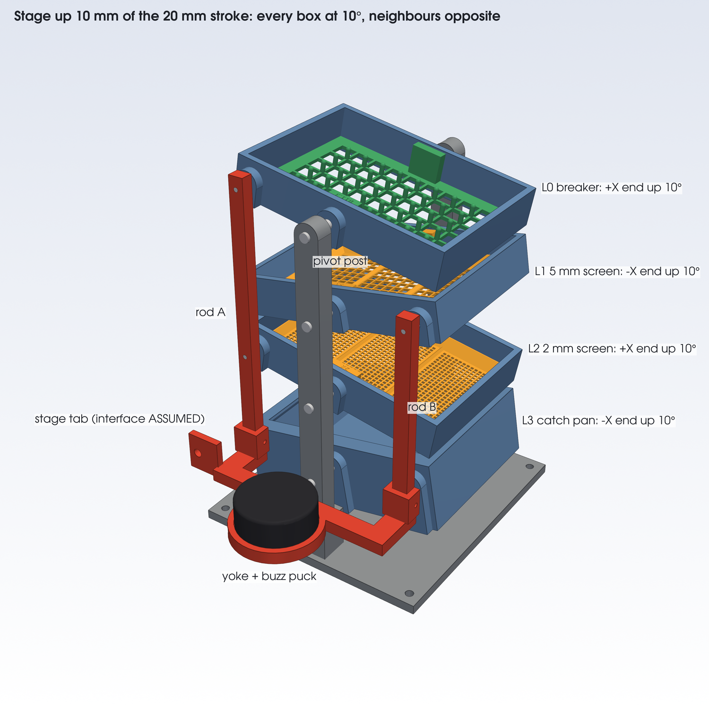
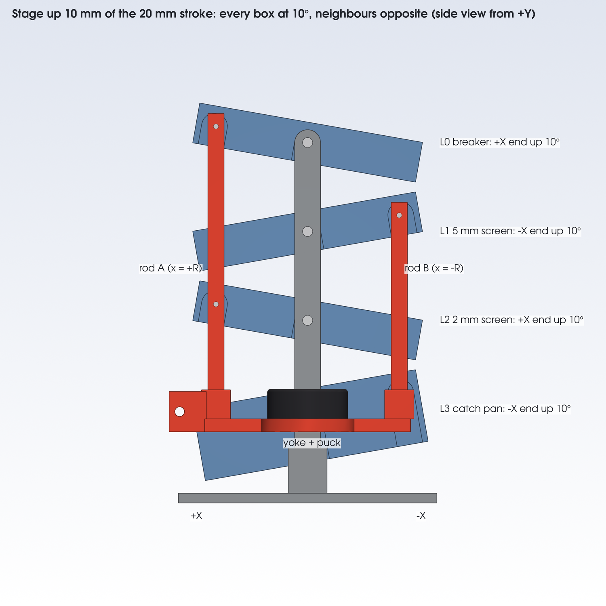

# The product: build sheet

## What it is

A stack of four boxes that rock like seesaws, driven by BugSorter's one linear stage. From the top:
- **L0:** the breaker, B-164f355a;
- **L1:** the 5 mm ribs-across screen;
- **L2:** the 2 mm ribs-across screen;
- **L3:** the catch pan.

Each box tips about its own pivot, a Y axis through its centre at mid-height. The pivots are 55 mm apart. Two push rods on a yoke turn the stage's up-and-down stroke into the seesaw. Rod A drives L0 and L2, and rod B drives L1 and L3, so neighbours always tip opposite ways. The default 20 mm stroke gives ±10°. A tactile transducer on the yoke adds the 40 Hz buzz. Samples go in from above. Nothing crosses over the top, so the spray reaches the breaker.

**Nothing here has been printed or tested.** See [ASSUMED / unverified](#assumed--unverified) and [../docs/EVIDENCE.md](../docs/EVIDENCE.md).

## Parts to print

P1S, Bambu Studio's default PLA process, each part sliced on its own by `slice.py`. All parts are valid single solids, watertight, fit the bed and need no supports. The new parts print in the orientation of their STL. Posts and rods lie on their side so their pin holes print vertical.

| Part | Script | Count | Time each | PLA each | Level |
|---|---|---|---|---|---|
| `seesaw_holder_drive_a` | `seesaw_holder.py` | 2 | 62 min | 42.5 g | L0, L2 |
| `seesaw_holder_drive_b` | `seesaw_holder.py` | 1 | 62 min | 42.5 g | L1 |
| `seesaw_catch_pan_drive_b` | `seesaw_holder.py` | 1 | 128 min | 98.6 g | L3 |
| `breaker_o11p3_b1p6_d3p1_h8_p8p5_round` (B-164f355a) | `breaker_layer.py` | 1 | 57 min | 19.6 g | in L0 |
| `sieve_insert_5mm_across` | `sieve_insert.py` | 1 | 47 min | 21.2 g | in L1 |
| `sieve_insert_2mm_across` | `sieve_insert.py` | 1 | 65 min | 22.5 g | in L2 |
| `product_post` | `product.py` | 2 | 27 min | 18.5 g | frame |
| `product_base` | `product.py` | 1 | 106 min | 92.7 g | frame |
| `product_yoke` | `product.py` | 1 | 36 min | 22.6 g | drive |
| `product_rod_a` | `product.py` | 1 | 14 min | 8.6 g | drive |
| `product_rod_b` | `product.py` | 1 | 11 min | 6.2 g | drive |
| **Total** | | **13** | **11 h 44 min** | **457 g** | |

The breaker and insert times come from `../sim/opt/print_plan.md`; the rest were sliced on 2026-10-27.

**The drive lug.** Each box is `seesaw_holder.py`'s holder, plus one more lug on its +Y long wall:
- the pivot lug's D shape, 16 mm wide and 6 mm out;
- a blind horizontal slot along the box's X: 3.3 mm wide, 6 mm deep, at the pivot height;
- centred toward +X on `_drive_a` and toward −X on `_drive_b`.

The slot covers the pin up to ±20°. It stays inside the box's outline, so it doesn't change the pitch.

## Hardware to buy

| Item | Qty | Where it goes | Note |
|---|---|---|---|
| Ø6 × 30 mm steel pin (dowel, or a clevis pin with a head) | 8 | post → box pivot lug, 2 per level | 6.2 mm holes; 8 mm in the lug, 2 mm proud outside the post |
| Ø3 × 14 mm steel dowel pin | 4 | the rods' cross-pins | pressed into the rod, flush outside; 4.5 mm sits in the slot |
| M3 × 25 bolt + nut | 2 | rod foot in the yoke's socket | |
| M4 × 30 bolt + nut | 2 | post in its pedestal | |
| M6 bolt + nut | 1 | yoke tab to the stage | length depends on the stage (ASSUMED) |
| M5 bolt | 4 | base to the bench | optional |
| Tactile transducer, Dayton TT25-8 or the same size (about Ø50 × 20 mm, 8 Ω) | 1 | the yoke's pad, axis vertical | 50.6 × 1.5 mm locating recess; VHB tape or the puck's own screws (hole pattern not modelled) |
| Small class-D amplifier board, 12 V supply | 1 | Pi headphone jack → amp → puck | match it to the puck's rated power on its datasheet |
| 3.5 mm audio lead, speaker wire | 1 each | | |

The Pi runs `pi/buzz.py`, e.g. `python3 buzz.py -f 40 -s 1`.

## Assembly

1. **Check the printed holes.** Print `hole_gauge.py` first. The 6.2 mm pivot holes and 3.0 mm cross-pin holes print small; drill or ream them to fit.
2. **Frame.** Push each post into its pedestal socket (18 mm deep), round top up, holes along Y. Fit an M4 × 30 bolt across each. Bolt the base to the bench with its +Y side toward the stage.
3. **Rods.** Press a Ø3 × 14 dowel into each rod hole from the outer face until it's flush. 6 mm stands out on the inner face: 1.5 mm gap, then 4.5 mm in the slot.
4. **Yoke.** Stand each rod in its U socket, pins toward the boxes (−Y). Rod A goes at the tab end (+X); rod B goes at −X. Fit an M3 × 25 bolt through each boss.
5. **Puck.** Seat it in the pad's recess and fix it. Run its lead along the yoke.
6. **Stage.** Bolt the yoke's tab to the stage carriage with the M6 bolt. Move the stage to mid-stroke: then the cross-pins sit at the pivot heights, 58, 113, 168 and 223 mm above the base's underside.
7. **Boxes, bottom first.** Order: pan (`_drive_b`), then L2 (`_a`), L1 (`_b`), L0 (`_a`). For each box:
   - drop its insert in first (the 2 mm in L2, the 5 mm in L1, the breaker in L0);
   - bring the box in from one end along X, held 6 mm toward −Y, so its drive lug clears the cross-pin;
   - move it +Y onto the pin;
   - push a Ø6 pin through each post into the lug's blind hole.
8. **Level and stroke.** At mid-stroke all four boxes should sit level. In the web app, set the top and bottom positions 10 mm either side of that point. Check ±10° with a phone inclinometer on L0's rim.
9. **Buzz.** Play 40 Hz with `buzz.py` and measure what a box rim does (see the buzz notes below).

**Swapping an insert:** stop at mid-stroke. There is 30 mm between one box's rim and the box above. Lift the insert 22 mm by its pull tabs, then slide it out along X over the end wall. Its tabs clear the box above by 9 mm.

**Taking a box out:** pull its two pivot pins out through the posts, slide it 6 mm toward −Y off its drive pin, then slide it out along X.

## How the stroke sets the angle

When the stage rises by u from mid-stroke, every box tips by θ = atan(u / R), and u is half the stroke. R = 56.71 mm, the pivot-to-pin distance at rest.
- It's **atan, not asin**, because the slot is fixed in the box and the rod stays vertical.
- The pin slides out along the slot by R (1/cos θ − 1): 0.87 mm at 10°.
- R was picked so the firmware's default 20 mm stroke gives exactly ±10°. The brief's R = 57.6 mm (from asin) would give ±9.85°.

| Stroke | Tilt | Closest neighbours | Note |
|---|---|---|---|
| 9.9 mm | ±5.0° | | |
| 13.9 mm | ±7.0° | | B-164f355a's sim motion |
| **20 mm** | **±10.0°** | **6.1 mm** | **firmware default** |
| 22.7 mm | ±11.3° | 3.0 mm | largest stroke that keeps 3 mm between neighbours |
| 25.4 mm | ±12.6° | 0 | the boxes touch |
| 30 mm | ±14.8° | collide | |
| 40 mm | ±19.4° | collide | |

- **Set the stroke** with the web app's top and bottom positions. `STEPS_PER_CM` is an uncalibrated placeholder, so measure the real stroke with calipers.
- **Bigger angles need more pitch.** For ±15°, hang the levels 65 mm apart. That means new posts and rods: change `PITCH` in `product.py` and rebuild.
- **The period** comes from the stage speed v: one cycle takes 2 × stroke / v.
  - 20 mm at the default 0.5 cm/s: 8 s per cycle.
  - At the 5 cm/s cap: 0.8 s per cycle.
  - B-164f355a's sim motion (±7°, 1.1 s per cycle) is a 13.9 mm stroke at 25 mm/s.
- **The angle profile.** The firmware's constant speed gives a near-triangle angle, with hard reversals.

**The buzz.** The sim's best runs add 0.35 mm at 40 Hz: 2.3 g peak (0.35 mm × (2π × 40 Hz)²).
- The puck sits on the yoke, so the buzz reaches each box through its rod as a fast rock. At the pin it's ±0.35°: the ends move ±0.43 mm, and the middle doesn't move.
- The sim instead moves the whole tower straight up (`rocking.py` `vib_mm`). These are different motions. `vib_deg=0.35` is the closer sim model. Which one sorts better is untested.
- Mounting the puck on the base plate instead would buzz the whole tower, as in the sim.

## Clearances

From `out/product_checks.json`: real solids at both ends of the default stroke (u = ±10 mm).

| Between | Gap |
|---|---|
| Neighbouring boxes (lugs included), every pair | 6.1 mm |
| Rod and its own drive lug face | 1.5 mm |
| Rod and the boxes it doesn't drive | 7.5 mm or more |
| Cross-pin in its slot (radial play) | 0.15 mm |
| Post and pivot lug | 8.0 mm |
| Yoke bar and +Y pedestal | 2.0 mm |
| Pivot pins and the drive | 5.0 mm |
| Rod B's socket and the pan's drive lug (sideways) | 1.5 mm |
| Pan and pedestals (sideways) | 4.0 mm |
| Pan and base plate | 7.8 mm at 10°, 2.5 mm at 15° |
| Insert or breaker top below its box rim | 1.0 mm |

**Envelope.** At rest: 166 × 228 × 236 mm (X × Y × Z, base underside to L0's rim). Over the default stroke, L0's rim reaches 248 mm. Y runs from −86 mm (base) to +142 mm (the puck's pad on the +Y side).

**Stage bolt.** At mid-stroke the yoke's tab hole is at (79.2, 90.0, 46.5) mm: Ø6, along Y. ASSUMED.

## Files

| File | What |
|---|---|
| `product.py` | Builds everything below. Run `~/venvs/sieve/bin/python product.py` in WSL: about 3 min, 2 GB peak. `product.py parts` exports only the printable frame and drive parts. |
| `seesaw_holder.py` | The holder and catch pan, plus the three drive variants |
| `out/product_assembly.step` | cq.Assembly with named, coloured parts, at rest (local, not committed) |
| `out/product.png`, `out/product_side.png` | The renders above, at +10° |
| `out/product_checks.json` | Tilt per stroke, clearances, envelope, file sizes |
| `out/product.glb` | For a web viewer. Nodes `frame` (static), `level0`–`level3`, `drive`; each has a child mesh per role (`holder`, `screen`, `breaker`, `frame`, `steel`, `drive`, `puck`), with a material named after the role. Vertices at rest, in metres, Y up: glTF (x, y, z) = CAD (x, z, −y) / 1000. |
| `product_view.py` → `out/product_view.html` | The interactive page: the GLB animated by the drive, with BugSorter's stroke and speed as sliders. Standard library only. Published at https://claude.ai/artifact/5EDjukCiJH2rjHP8DB8uS1 |
| `out/product_kinematics.json` | Per level: pivot, sign, drive x. Plus R, pitch, units, the GLB axes and the rotation law. |
| [`../docs/assets/product.stl`](../docs/assets/product.stl) | The whole machine at +10°, coarse (96,094 triangles, 4.8 MB), for GitHub's 3D viewer |

**Driving the GLB.** For a stage position u in mm:
- move the `drive` node by u / 1000 along +Y;
- rotate each level node about +Z through its `pivot_gltf_m` by sign × atan(u / R). A positive angle lifts the +X end.

In the CAD frame, that's φ = −sign × atan(u / R) about +Y, with φ > 0 tipping +X down, as in `sim/rocking.py`. Its signs (+1, −1, +1, −1 from the top) are the same.

## ASSUMED / unverified

1. **The box dimensions were never measured.** `frame_holder.py` rebuilt them from a drawing, which was itself reconstructed from four photos. `WALL` and `LEDGE_T` are guesses. Every part here takes its size from that box.
2. **The stage interface is unknown.** The yoke's tab copies the old box tab (22 × 4.5 × 25 mm, Ø6 hole 6.5 mm from the end), so it should take the same bolt. Where the stage carriage sits relative to the stack isn't known. The model needs its bolt at (79.2, 90.0, 46.5) mm at mid-stroke.
3. **The stage may not move vertically.** The drive assumes it does: the firmware has top and bottom limit switches, like the vertical EntoSieve. The team was told the bench unit's motion is horizontal. If so, the yoke needs a bell crank, which isn't designed.
4. **The stroke isn't calibrated.** `STEPS_PER_CM = 100` is a placeholder, so a commanded 20 mm may not be 20 mm, and the angle won't be 10°.
5. **The linkage is untested.** Unknowns:
   - friction and wear of steel pins in printed slots and holes;
   - the 0.15 mm play;
   - binding;
   - whether a 10 × 8 mm PLA rod stays straight;
   - the shock at each hard reversal.
6. **Nothing has been printed or tested.** Times and grams are Bambu Studio estimates.
7. **The buzz path is unverified.** Three concerns:
   - The yoke hangs on the stage's lead screw, which is stiff along its axis, so the puck may not move it 0.35 mm at all. Measure a box rim with a phone accelerometer.
   - The slot's 0.15 mm play is under half the buzz amplitude, so the pin will knock in the slot.
   - The buzz reaches the boxes as a rock, not the sim's straight-up shake.
8. **Nothing holds the pivot pins in.** Vibration may walk them out. Tape or a set screw would do; neither is modelled.
9. **Printed holes come out small.** Check them with `hole_gauge.py`.
10. **PLA in ethanol.** The parts sit under an ethanol spray, and PLA's long-term resistance to it hasn't been checked.
11. **The puck is a stand-in.** It's modelled as a Ø50 × 20 mm disc, the TT25-8's size. Its mounting holes and cable aren't modelled.
