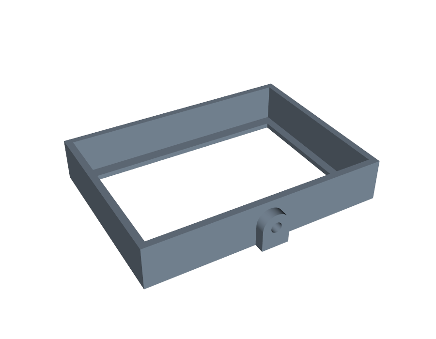
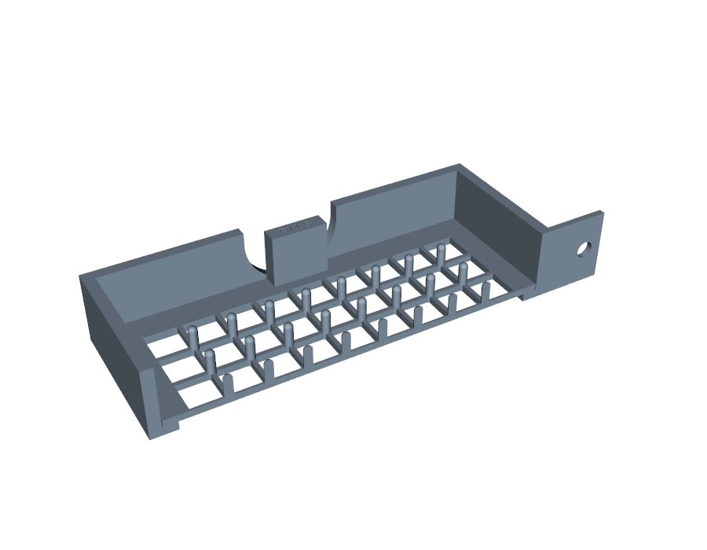
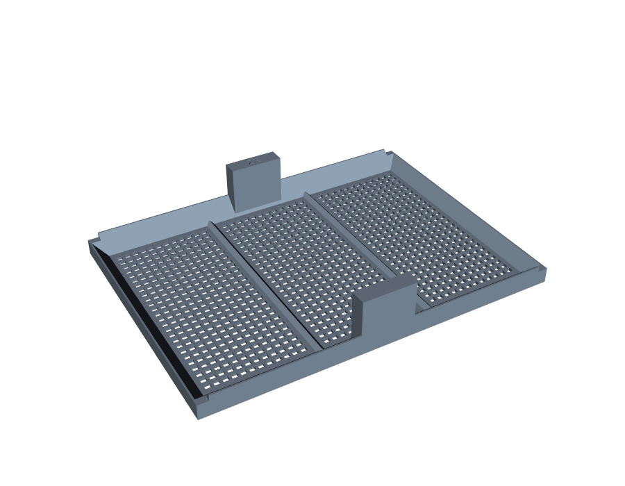
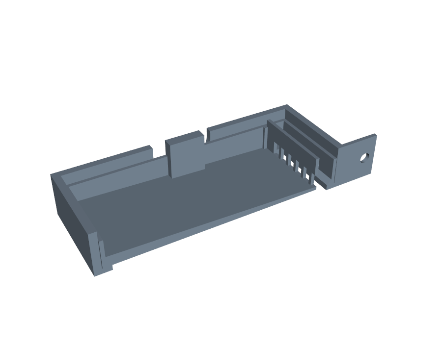
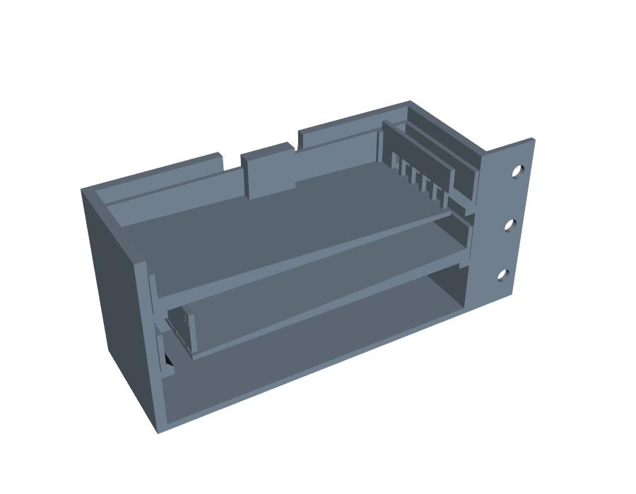
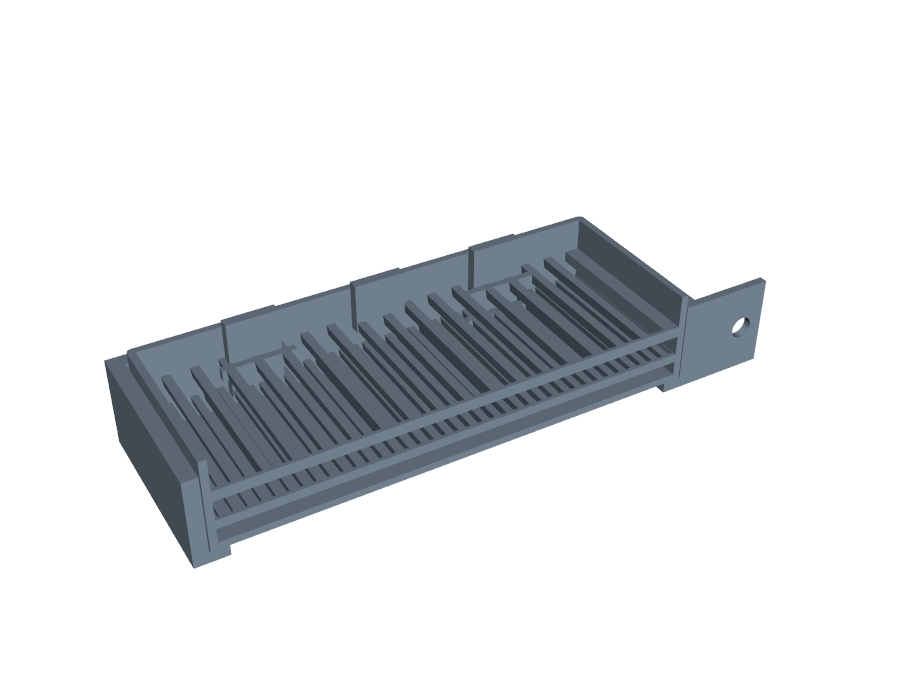
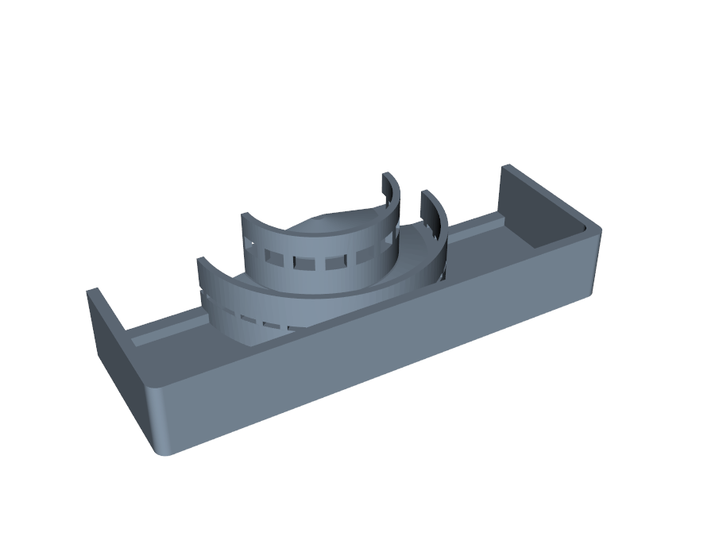
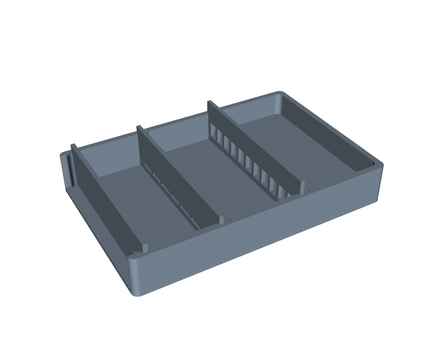

# CAD

Every printable part, as a CadQuery script with every dimension a named parameter at the top.

- **Running a script:** run it from this folder with the WSL venv's Python, e.g. `~/venvs/sieve/bin/python seesaw_holder.py`. On the Windows laptop, Smart App Control blocks CadQuery's DLLs (see the main [README](../README.md#running-the-code)).
- **Outputs:** each script writes `out/<part>.step`, `out/<part>.stl`, a `.png` preview and `<part>_checks.json` (valid solid, watertight, bed fit, printability flags).
- **What's committed:** previews and checks. STL, STEP and sliced files are rebuilt (about 2 min) and stay local; `../docs/assets/product.stl` is the one exception.

## The build

13 printed parts: 11 h 44 min and 457 g of PLA on the P1S. The whole machine is in **[PRODUCT.md](PRODUCT.md)**: the parts to print, the hardware to buy, the assembly steps, how the stroke sets the angle, and what's still assumed. `product.py` builds the assembly (`out/product_assembly.step`) and the web model (`out/product.glb`). [`../docs/assets/product.stl`](../docs/assets/product.stl) opens in GitHub's 3D viewer.

| Level | Part | Script |
|---|---|---|
| Top | Breaker B-164f355a: 9 × 6 openings of 11.3 mm, 40 round pins 3.1 × 8 mm, 57 min and 19.6 g on the P1S | `breaker_layer.py` |
| 2 | 5 mm ribs-across sieve insert | `sieve_insert.py` |
| 3 | 2 mm ribs-across sieve insert | `sieve_insert.py` |
| Bottom | Lipped catch pan | `seesaw_holder.py` |
| Every level | Seesaw holder box: pivot lugs in the middle of each long wall, and a drive lug with a slot for the push rod's cross-pin (`_drive_a` at +X, `_drive_b` at −X) | `seesaw_holder.py` |
| Frame and drive | Base, pivot posts, push rods, yoke | `product.py` |

**Nothing here has been printed and tested yet.** The box dimensions are reconstructed from a drawing, not measured. See [../docs/EVIDENCE.md](../docs/EVIDENCE.md).

### Seesaw holder and catch pan (`seesaw_holder.py`)

- **Same body as BugSorter's box** (`frame_holder.py`): same pocket, ledge and open bottom, so every insert and the breaker drop in unchanged.
- **No mounting tab.** Each box hangs from two Ø6 pins through lugs in the middle of its long walls, so it tips about its own centre. Without the tab, levels can hang 55 mm apart at ±10° instead of about 60. The drop between levels is where specimens are hit hardest, so closer is gentler.
- **Catch pan:** the same rim and pivot on a deeper body, with a solid floor and an inward lip, so grains that bounce at the ends stay in.
- Level spacing for each tilt: `seesaw_tower.py` and [WORKING_DIMENSIONS.md](WORKING_DIMENSIONS.md).

### Breaker layer (`breaker_layer.py`)

- **Shape:** a square grid with blunt pins on the grid nodes, the same footprint and pull tabs as an insert.
- **How it works:** the motion throws the clump onto the pins, and the spray weakens it. Freed specimens fall through the grid, and leaves stay on top.
- **Specs:** it takes the optimizer's spec string as is, e.g. `python breaker_layer.py "open=11.3,bar=1.6,pin_d=3.1,pin_h=8,pitch=8.5,tip=round"`. The build uses that one, B-164f355a, the winner in [../sim/opt/leaderboard_malaise.md](../sim/opt/leaderboard_malaise.md).

### Sieve inserts (`sieve_insert.py`)

Printable versions of BioKEA's flat 2×3-window inserts with pull tabs, with the mesh printed in as square holes instead of glued on.

| Part | Holes | Bars | Screen thickness |
|---|---|---|---|
| `sieve_insert_5mm` | 150 holes, 5.0 mm square | 1.2 mm | 1.6 mm |
| `sieve_insert_2mm` | 726 holes, 2.0 mm square | 1.0 mm | 1.4 mm |

**Shape:**
- Insert 131.4 × 95.4 mm, frame 3 mm thick
- Border 10 mm, ribs 3 mm, six windows of 35.1 × 36.2 mm
- Two pull tabs, 20 × 6 mm and 18 mm tall, in the middle of the long edges; the hole size is debossed on one tab's top

**Printing:**
- The screen sits at the bottom of each window, on the print bed, so it prints without bridging. It ends up 1.4–1.6 mm below the frame's top surface; glued mesh sat on top.
- Holes widen 8° downward so near-size grains fall free.
- Flat, right side up, no supports.

**Sizes:** measure an existing insert and correct `BORDER`, `RIB`, `FRAME_T` and the tab sizes. The outside size follows the `frame_holder.py` pocket.

**Ribs-across variants** (`sieve_insert_5mm_across`, `sieve_insert_2mm_across`) are the ones in the build. On the seesaw the ends tip, so grains slide along X. The sim found small grains riding ribs that ran along the tilt, so these variants have just two low 45° ridges, both running across it, and a 45° ramp at the border.

### Working dimensions

The holder box and sieve inserts are the current working design. The numbers are listed in [WORKING_DIMENSIONS.md](WORKING_DIMENSIONS.md).

**Opening in Bambu Studio:** every STL is a separate part, centred on the same origin.
- If Bambu Studio asks whether to load several files as a single object, click **No**, then press **A** (Arrange) to lay them out.
- Clicking **Yes** stacks the parts on top of each other in one spot.

## Tools

| Script | What it does |
|---|---|
| `hole_gauge.py` | Test coupon of holes and slots. Print it first and pour each grain over it, so the aperture numbers match what your printer makes. |
| `slice.py` | Slices parts with Bambu Studio's CLI for the P1S and reports time and grams |
| `winners.py`, `build_winners.py` | Build, render and slice every part of the optimizer's winners (`../sim/opt/winners*.json`) |
| `product_view.py` | Builds the interactive 3D page of the whole machine from `out/product.glb` |
| `seesaw_tower.py` | The minimum level spacing for each tilt, from the real solids |
| `frame_holder.py` | BugSorter's original holder box with its +X mounting tab, reconstructed from a drawing |
| `cadkit.py` | The shared export step: STEP, STL, PNG preview and checks |

## Earlier designs (explored, not in the build)

These came first, during the hackathon. They still build, and the sim still runs them, but the build settled on separate seesawing trays with printed screens.
- **Gated containers:** the optimizer found they can't sort on a plain symmetric seesaw. The mid-slot ramp version only sorts with a fast shake thrown upward.
- **Plinko rod layers:** these score highest in the sim, but as one box rocking as one piece (`../sim/opt/leaderboard_seesaw.md`).

### Plate-sized sieve system (`sieve_system.py`)

Every part is exactly the size of a 24-well plate (127.76 × 85.47 × 20.27 mm), so it drops into any plate holder, plate shaker or plate gripper. A 3 mm lip under each part nests into the part below. The lip sits inside the 20.27 mm height.

**Stack, top to bottom:**

| Part | What it does |
|---|---|
| `lid` | Keeps grains from bouncing out |
| `tray_coarse_5p0` | 5.0 mm round holes. Pasta stays on top; rice and quinoa pass. |
| `tray_fine_2p3` | 2.3 mm round holes, for short-grain rice vs. quinoa |
| `tray_fine_slot_1p3` | 1.3 × 12 mm slots, which sort by thickness. Use this one for long-grain rice vs. quinoa. |
| `collector` | Sealed bin for whatever passes the fine tray (about 177 mL) |

**Also:**

| Part | What it does |
|---|---|
| `tray_open` + `clamp_ring` | Frame for a 121.2 × 78.9 mm piece cut from the kit's metal sheets. Clip the corners, drop it on the ledge, press the ring on top. |
| `tier_coarse` + `tier_fine` | Tiered concentric sorter that sits in `collector` (see **Tiered sorter** below). Built by `tiered_sorter.py`. |
| `gate_coupon_2p3`, `gate_coupon_5p0` | The gates idea, to run beside a perforated tray. Grains start on a raised deck, pass between tapered posts, and drop 5 mm into a pocket. Shake along the long side. |
| `pool` + gate strips | One open plane, shaken along the long side, with swappable gates (see **Pool sorter** below). P1S estimate: 58 min, 44 g. |
| `pool_coupon` | One gate slot of the pool (46 mm long), to check the strip fit and gate behaviour before printing the pool. 29 min. |

**Design notes:**
- Every hole and slot widens 8° downward, so near-size grains fall through instead of wedging.
- Inner corners are rounded.
- Each part's label is debossed on its +X end wall.

**Build:** from this folder, run `python sieve_system.py`, or name specific parts after the command.
- STL and STEP files land in `out\` but aren't committed: rebuilding them takes about 2 min.
- Previews (`.png`) and checks (`_checks.json`) are committed.
- Print `hole_gauge.py` first and pour each grain over it, so the aperture numbers match what your printer actually makes.
- **The design optimizer's winners:** `winners.py` runs from the Windows `.venv` (it calls Bambu Studio). It builds every part of each winner in `../sim/opt/winners.json` (in WSL, through `build_winners.py`), renders a cut-away of its tower, and slices each part. Parts land in `out\win<rank>_*`, and the times, grams and printability flags go in `../sim/opt/print_plan.md`.

**Changing sizes:** every dimension is a named parameter at the top of `sieve_system.py`. `cadkit.py`, `hole_gauge.py` and `slice.py` are copies from `Documents\BioKEA-hack\cad`.

### Gated container (`gated_container.py`)

A drop-in replacement for the mesh inserts in the BugSorter tower: same 131.4 × 95.4 mm footprint and the same pull tabs, shaken longways. The tabs stop 1 mm under the box rim so the boxes stack rim on rim; grip them through the box's finger notches.

**How it sorts:**
1. The floor is solid and slopes 2° toward a gate strip at the +X end. Shaking walks grains, and the spray water, down to the gate.
2. Anything that fits through the gate drops through the slot just past it, over the box's open bottom, onto the next level. It can't come back.
3. Anything too big stays in the container. Lift it out by the tabs and put it in the pool.

**Gate strips** slide into rails and swap out, so you can change the cut without reprinting the container. They print flat (about 7 min each), which puts the gap width and tunnel height in the printer's accurate XY plane.

| Strip | Openings | Cuts by |
|---|---|---|
| `gate_w5p0`, `gate_w3p0`, `gate_w2p0` | Width gaps 5.0 / 3.0 / 2.0 mm, 8 mm tall | The narrower side of a flat-lying grain |
| `gate_t1p2`, `gate_t1p4`, `gate_t1p6` | Tunnels 8 mm wide, 1.2 / 1.4 / 1.6 mm tall | Thickness. Long-grain rice (~1.7 mm) stays; quinoa (~1.0 mm) passes. |

**In the tower, flip the container 180° on every other level.** That way, what drops from the level above lands on the solid end of the next container instead of falling straight through its slot.

Dimensions are in [WORKING_DIMENSIONS.md](WORKING_DIMENSIONS.md).

### Plinko layers for the holder box (`plinko_layers.py`)

Drop-in layers that replace the glued-mesh inserts in BioKEA's box (`frame_holder.py`). All three stack inside one box. Load on top, shake along the box's long side (X), and spray from above as usual.

| Layer | Floor | Keeps | Pull tabs |
|---|---|---|---|
| `layer_1_rods_5p0` (top) | 16 rods, gap 5.0 mm | Pasta | x = 0 |
| `layer_2_rods_1p4` | 37 rods, gap 1.4 mm | Long-grain rice (~1.7 mm thick) | x = −35 |
| `layer_3_catch` (on the ledge) | Solid | Quinoa | x = +35 |

**How it sorts:**
- Rods run across the box, perpendicular to the shake, so grains hop across them and tip into the gaps.
- A flat grain that tips into a gap is sorted by its thickness, which is what splits long-grain rice from quinoa.
- Rods narrow 8° downward, so a grain that gets in falls free instead of wedging.

**Unloading:**
- Lift the layers out top-down: pasta, then rice, then quinoa.
- Each layer is a walled tray, so it keeps its catch while you lift it. It can go straight into the water pool, like the current mesh filters.
- Every layer's tabs stand 6 mm above the box rim. Lower layers' tabs pass through 0.3 mm-clearance slots in the layers above.

**Sizes:** layers are 131.4 × 95.4 mm (the frame holder's guessed 132 × 96 mm pocket, minus 0.6 mm clearance). Measure the real box, then change `WALL` and `LEDGE_T` in `frame_holder.py`; the layers follow. Change gaps and heights in `LAYERS`.

### Round layer stack (`round_stack.py`)

Full layers, all the same size (85 mm across, 20.27 mm tall), with the gates in each floor. Anything smaller than a layer's gates falls through to the layer below. Each layer's lip nests into the rim of the one below, and each layer lifts off carrying its own class.

| Part | Gates | Keeps | Passes |
|---|---|---|---|
| `round_lid` | — | — | — |
| `layer_x_square_5p0` | 73 square, 5.0 mm | Pasta | Rice, quinoa |
| `layer_y_slot_1p4` | 95 slots, 1.4 × 10 mm | Long-grain rice (~1.7 mm thick) | Quinoa (~1.0 mm thick) |
| `layer_y_square_2p3` | 261 square, 2.3 mm | Short-grain rice | Quinoa (swap in instead of the slot layer if your rice is short-grain) |
| `round_collector` | — | Quinoa | — |

- **Square gates** sort by width. **Slots** sort by thickness: shaking tips grains edge-first into a floor slot, the way grain graders sort barley.
- Every gate widens 8° downward, so near-size grains fall free.
- Prints flat, right side up, no supports. Rebuild with `round_stack.py` and change sizes in `LAYERS`.

### Tiered sorter (`tiered_sorter.py`)

Circles with gates on separate tiers: a small coarse tier sits on a bigger fine tier, which sits in the plate-sized `collector`. Load the mix on top of the coarse tier and shake.

**The physics it relies on:**
- **Push.** Each tier's floor is a 10° cone, high in the middle. Still, nothing slides: rice on plastic needs about 22°. Shaking at roughly 0.2–0.3 g makes grains flow downhill to the rim.
- **Gate shape.** Shaking lays grains flat, so each gate is a low tunnel at floor level. The tunnel's height sets the thickness cut and its width sets the width cut.
- **One-way.** Whatever passes a tunnel drops 8 mm onto the tier below and can't climb back.
- **Unloading.** Lift each tier off; it carries its own size class.

**Tiers, top to bottom:**

| Part | Size | Tunnels | Keeps | Passes |
|---|---|---|---|---|
| `tier_coarse` | 40 mm cone | 17 tunnels, 5.0 wide × 4.0 high | Tube pasta | Rice, quinoa |
| `tier_fine` | 66 mm cone | 34 tunnels, 4.0 wide × 1.4 high | Long-grain rice (~1.7 mm thick) | Quinoa (~1.0 mm thick) |
| `collector` | plate-sized bin | — | Quinoa | — |

**Fit.** A peg on `tier_fine` centres `tier_coarse`. Four feet centre `tier_fine` in the collector.

**Printing.** Each part prints flat on its base with no supports. Only the tunnel ceilings bridge, over 4–5 mm. Print at 0.2 mm layers so the 1.4 mm tunnels are exactly 7 layers.

**Caveats:**
- Keep pasta to about 10 short pieces (under 25 mm). The 40 mm top tier fills fast, and pasta lying against the rim covers tunnels.
- Flat pasta such as farfalle is thinner than 4 mm and will pass the coarse tier.

**Rebuild:** run `python tiered_sorter.py`. Change sizes in `TIERS` and `SLOPE_DEG`.

### Pool sorter (`sieve_system.py`)

**Layout.** Load at the +X end. The floor steps down 3 mm at each gate toward the open -X end:

| Zone | Floor | Length |
|---|---|---|
| Load | z 8 | 45 mm |
| Middle | z 5 | 40 mm |
| End | z 2 | 34 mm |

The drop biases grains forward; it isn't a one-way valve. Each gate is a separate 2 mm strip that slides into grooves in the side walls and lifts out. A dam strip closes the open end.

**Strips.**
- Print them lying flat, so the gap width and tunnel height come out in the printer's accurate XY plane. They take 6 to 7 min each; put the whole set on one plate.
- Any gate fits either gate slot.
- Width gates cut by width and thickness gates by thickness:

| Strip | Opening | Cuts by |
|---|---|---|
| `pool_gate_w5p0`, `_w3p0`, `_w2p3` | Gaps 8 mm tall | Width. Pasta vs. rice; a short tube can pass end-first. |
| `pool_gate_t3p0`, `_t1p6`, `_t1p5`, `_t1p4`, `_t1p3`, `_t1p2` | Tunnels 8 mm wide | Thickness of a flat-lying grain. Rice (~1.7 mm) vs. quinoa (~1.1 mm). |
| `pool_dam` | None | End dam, and the cover that closes a gate before you pour. Print 3. |

**Run:**
1. Push about 30 grains of each type through the strips by hand, without forcing them. Measure the printed openings, since the first layer can narrow them. Pick the strips from that, for example `w5p0` in gate slot 1 and `t1p4` in gate slot 2. Clear any grain from a groove before seating a strip: a grain under a strip raises every tunnel.
2. Seat both gates and the end dam. If strips lift while shaking, hold them down with tape or a rubber band over the tops.
3. Load at the +X end and shake along X.

**Unload one fraction at a time.** Keep the tray level between steps and check the downstream floor for strays.
1. Drop a dam into each gate's cover groove (just upstream of the gate). This closes the gates so tipping can't push grains through.
2. Pull the end dam and tip toward -X: the end fraction (quinoa) pours out.
3. Pull gate 2 and its cover: the middle fraction (rice) pours out.
4. Pull gate 1 and its cover: the load fraction (pasta, chickpeas) pours out.

**Grooves.** 2.3 mm wide for a 2.0 mm strip, 1.5 mm deep into the 3 mm walls. Strips reach 1.3 mm into each groove. If the fit is too tight or too loose, change `SLOT_FIT` and `END_FIT`. Print `pool_coupon` first to check.

**Review.** Codex Astra (`gpt-6-astra`) reviewed this design twice. Its verdict both times was "confirm with changes", and those changes are built in: a cover groove next to each gate, separate thickness and length fits, strips seated wholly upstream of the drop, solid strip ends, 1.3 and 1.5 mm tunnels, and the coupon. Still untested: forward transport under a symmetric stroke, the PUCK versus the bench stroke, and wet runs (quinoa thickness changes with moisture).
